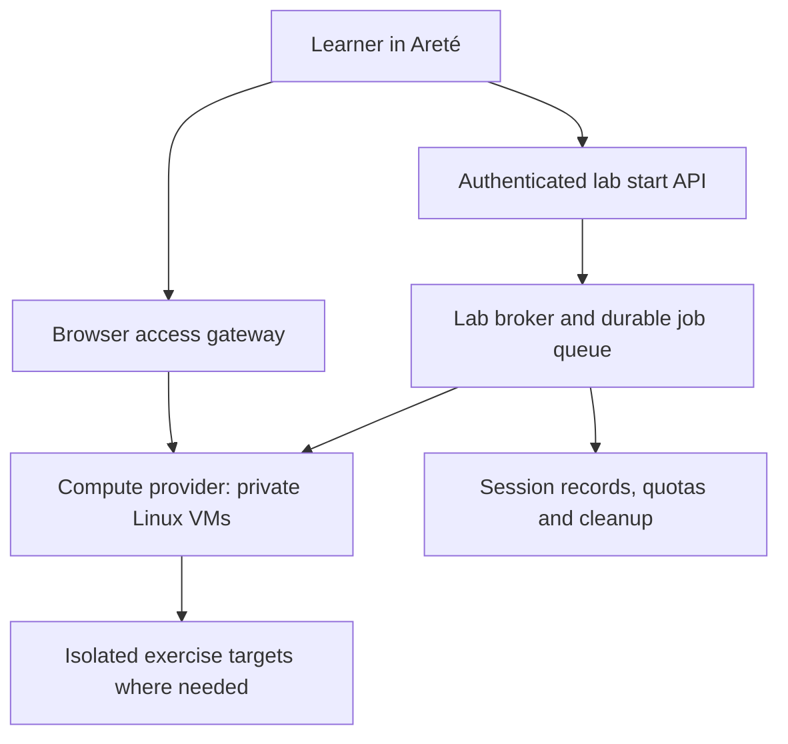

# Browser-accessible Linux practical labs

Date: 9 November 2026. Status: proposed architecture; no lab infrastructure has been provisioned.

Related: [career pathway plan](career-pathway-implementation-plan.md) and [SOC practical specification](defender-pathway-implementation-plan.md).

## Recommendation

Give each active learner a private, temporary Linux environment launched from the practical lesson. Start with an Ubuntu VM and browser terminal for Linux fundamentals. Add a desktop only for exercises that need graphical tools. For later authorized offensive exercises, provision a separate workstation and target inside that learner's private lab network.

The learner uses a browser; Linux runs on rented compute, so installing Linux locally is not a prerequisite. A phone can access a browser session, but a laptop and keyboard are the recommended practical-work setup. Test actual latency, data use, mobile usability and reconnection with the intended Nigerian learner cohort.

Keep the existing Vercel-hosted application and short API operations. Put VM provisioning, session connections and lifecycle workers on dedicated infrastructure. The existing `CodePlayground.jsx` / `api/run.js` compiler flow is not a persistent Linux environment.

Use **Apache Guacamole as the browser access gateway**, with a separate broker creating and managing machines. Guacamole provides browser access to remote sessions; it does not provision the VMs. Its [official architecture documentation](https://guacamole.apache.org/doc/gug/guacamole-architecture.html) describes the browser client, gateway and `guacd` proxy.

## 1. Learner experience

1. Open a practical lesson and choose **Launch Linux Lab**.
2. Areté checks account, lesson eligibility, concurrency allowance and available capacity. It creates or resumes one authorized session and shows its startup state.
3. The learner opens a browser terminal beside the instructions, or initially in a separate lab tab. The lab contains the versioned exercise files and tools.
4. The learner performs the task, saves a notebook/report, checks their work and submits the required evidence.
5. **Reconnect** returns to a still-active session. **Reset** warns that unsaved machine changes will be discarded, then restores a clean exercise environment.
6. The session shows its remaining lease and idle warning. Before expiry, offer the permitted save/export action. Stop and clean up expired infrastructure automatically.

Practice and final-assessment sessions are separate. For assessments, reset/retry behavior must follow the published attempt rules and retain the immutable submission history. Avoid promising permanent home directories in the first release; explain which work is retained and for how long.

## 2. Components

The website decides who may request a lab. The broker selects an approved template, provisions resources, manages leases and records state. The gateway authorizes the connection and displays the terminal/desktop. A worker reconciles actual provider resources with session records and deletes or stops orphans even if the browser closes unexpectedly.

Authenticate with the existing verified Supabase identity. Implement a reviewed broker-to-gateway authorization integration; do not assume Guacamole automatically accepts an arbitrary Supabase token. Connection grants should be short-lived, bound to one owner/session and revocable. Provider credentials and guest connection secrets remain server-side. Clients cannot supply arbitrary VM images, remote hostnames, network IDs or connection destinations.

Start with a separate authenticated lab tab. Embedding later requires explicit checks of Areté's CSP, the lab gateway's frame policy, connection origins and cookie/session behavior. The current application headers do not authorize an external embedded lab origin; do not relax them with broad wildcards.

## 3. Choose the environment by the learning task

| Practical work | Environment | Example task |
|---|---|---|
| Linux foundations | Ubuntu VM, browser SSH terminal | Files, permissions, users, processes and log inspection |
| Blue/SOC | Linux VM with synthetic logs; desktop if a chosen tool needs it | Investigate account events and produce a timeline |
| Red/ethical testing | Workstation VM plus an assigned vulnerable target on an isolated network | Reproduce and report a permitted seeded finding |
| AppSec | Linux development VM with a local exercise application and test harness | Fix authorization and run permitted/forbidden access tests |
| GRC | Evidence viewer/report tools; VM only when an actual technical check is relevant | Compare policy requirements with supplied control evidence |
| Purple progression | Scoped workstation/target and defensive telemetry | Compare expected detection with observed events and retest |

Use Ubuntu for the initial Linux course. A curated Kali workstation can be an option for later offensive lessons when its tools are needed; it is not a prerequisite for learning Linux. The student workstation and vulnerable targets have no route to production databases, provider metadata/control APIs, management networks or other learners' labs. Apply isolation to IPv4 and IPv6, DNS and outbound traffic, not merely the visible website URL.

## 4. Alternatives and boundaries

| Option | Appropriate use | Trade-off |
|---|---|---|
| Cloud VM per active learner + Guacamole | Recommended initial real-Linux pilot, including exercises needing guest administration | Compute, gateway and lifecycle operations cost money and require maintenance |
| Hardened Linux containers | Later cost optimization for selected low-privilege introductory tasks | Containers share the host kernel; they are not full VMs or an equivalent default boundary for unrestricted offensive/root exercises |
| Kasm Workspaces | Evaluate if integrated browser desktops/session management would save engineering effort | Distinguish container workspaces from VM connections and confirm the applicable commercial/hosted-service terms before choosing it |
| Downloadable local VM | Optional offline/low-cloud-cost companion for learners with suitable computers | Installation, image download, hardware support and local grading require additional work |

[Docker's security documentation](https://docs.docker.com/engine/security/) explains its namespace/cgroup model and daemon risks. Do not expose a Docker socket, privileged host container or host filesystem to a learner. [Kasm's documentation](https://docs.kasm.com/docs) and [licensing information](https://docs.kasm.com/docs/reference/license) distinguish delivery and license options; a free evaluation is not assumed to authorize Areté's commercial hosted service.

For the VM pilot, use a provider that can create ordinary Linux VMs and isolated networks through an API. If instead consolidating guest VMs on a rented server, verify hardware virtualization/KVM or supported nested virtualization, networking and tenancy restrictions before purchasing it. A generic VPS is not automatically a suitable VM host.

## 5. Lab contract and assessment evidence

Each lesson declares its immutable template version, tools/artifact versions, initial state, required network access, resource limit, prerequisites, objective checks, learner outputs, reset policy and timeout. Build approved images in advance; avoid downloading tools every time a class starts. Patch templates and create new versions rather than silently changing active assessed attempts.

Example first task: inspect a supplied authentication log, identify suspicious successful access, correct an intentionally excessive permission in the learner's VM, verify the correction and submit a short evidence-backed explanation.

The server records session ID, owner, lesson/task version, provider resource IDs, lease, state and assessment-attempt link. States include `queued`, `starting`, `ready`, `stopping`, `stopped`, `failed` and `expired`; destructive resets create an auditable generation/version change. Use idempotent start/stop/reset operations and bounded retries.

Do not equate a VM opening, a command being typed, or a browser-supplied success flag with mastery. Guest state is learner-controlled, especially when the exercise grants root. Objective checks run from an appropriately isolated trusted system, use independent observations where possible, and never place grading secrets or reference answers in the guest. Human-reviewed explanations and reproducible evidence remain part of final assessment. A guest agent's claim alone cannot establish an independently verified result.

Save reports and permitted evidence to private owner-scoped storage before tearing down the lab. Minimize session recording; if recording is required, explain it and define access/retention before enrollment. Never record or reuse real production credentials or learner personal data as exercise material.

## 6. Capacity and cost controls

Begin with **five concurrent lab places**, not one permanently running VM per registered learner. Queue excess requests and publish class capacity. Pilot sizing hypotheses are 1–2 vCPU and 2 GiB RAM for a lightweight terminal lab, or 2 vCPU and 4 GiB for a small desktop; benchmark the actual image/tools before buying a plan. Offensive workstation/target pairs and heavier defensive tools need separate measured allocations.

Initial policy proposal: one active lab per learner, a 15-minute idle warning/expiry policy, a 90-minute maximum session lease with a controlled extension, per-day usage limits, and a global spend/concurrency cap. Test what counts as idle so an active background task is not unexpectedly lost; publish the policy with the lesson.

Budget from actual provider quotes:

`compute + target machines + gateway/worker + disks/snapshots + network traffic + any licensing + maintenance/support`.

For example, 20 learners using a single-machine lab for four hours each require 80 learner-VM hours; a workstation and equally sized target running for the same time would require 160 VM hours. These are usage examples, not quoted prices. Stopped machines may retain billable disks and other resources; [AWS's lifecycle guidance](https://docs.aws.amazon.com/AWSEC2/latest/UserGuide/how-ec2-instance-stop-start-works.html) is one provider example. Verify billing rules for whichever provider is selected and clean up retained resources deliberately.

Measure startup time, connection success, reconnect behavior, timeouts, cleanup success, learner-hours and cost per completed lab. Do not choose a hosting region only by headline price: test latency from the intended learner locations and confirm capacity and applicable data-handling needs.

## 7. Implementation order and release gates

1. Build one approved Ubuntu template and one meaningful Linux practical with its evidence/checking contract.
2. Provision a small staging compute network and access gateway separate from production data. Evaluate a provider and obtain a budget before provisioning paid capacity.
3. Implement the broker, session table, durable lifecycle queue, quota reservation and orphan reconciler. Creating a session and reserving a place must withstand concurrent requests and retries.
4. Integrate authenticated launch/status/reconnect/reset/stop controls into a practical lesson, preserving owner-scoped access and draft recovery.
5. Rehearse a complete task and human review, then test five concurrent learners, attempted cross-account access, isolation, lost network, expiry, provider failure and resource cleanup.
6. Run a capped Linux-foundations pilot, inspect actual learner work and cost, then add a desktop or workstation/target pair when the next course requires it.

Do not launch a VM feature that cannot reliably reclaim resources. Before inviting learners, demonstrate authorized connection access, immutable assessed task versions, working reset/expiry, no cross-learner/production reachability, recoverable submissions, cleanup after failure, and enforced capacity/spend limits.

This plan adds real infrastructure and operational work to the career roadmap. Confirm a delivery estimate after the provider/gateway prototype; do not assume the complete lab platform is already covered by an untested frontend-only implementation estimate.
